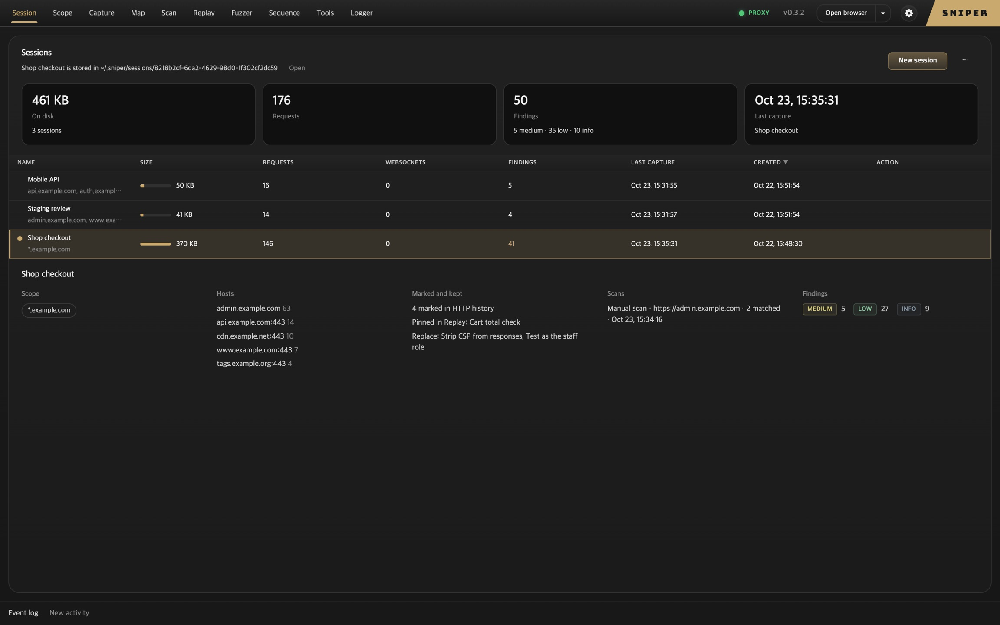
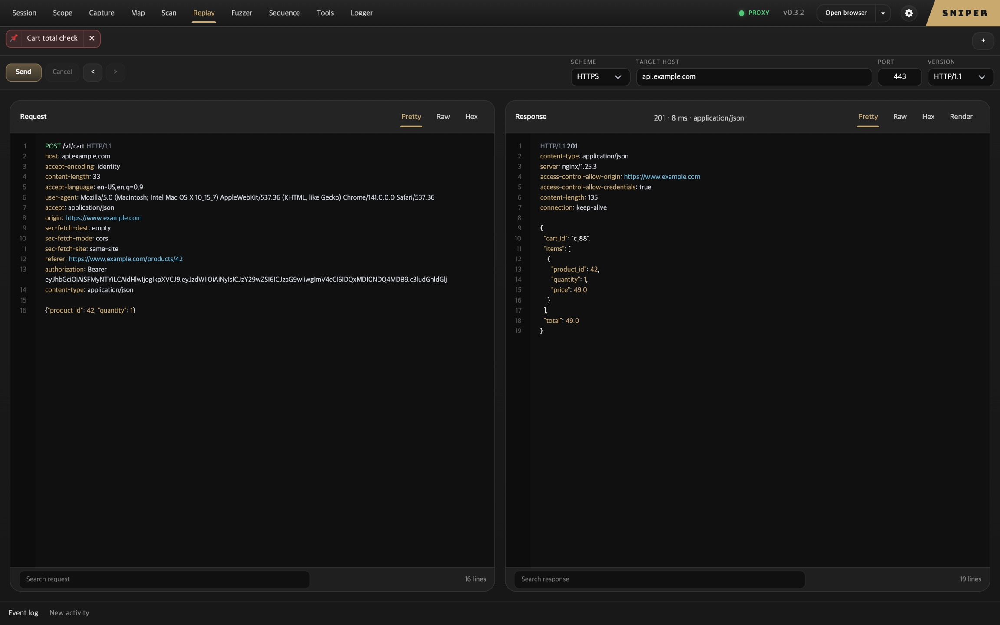
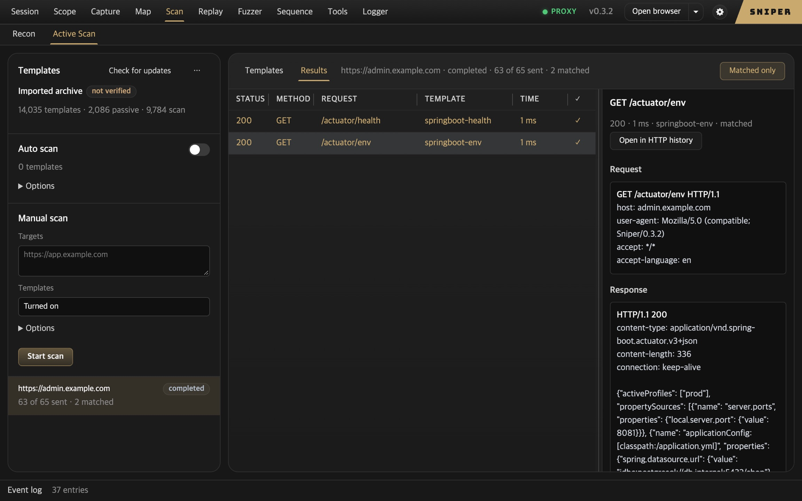
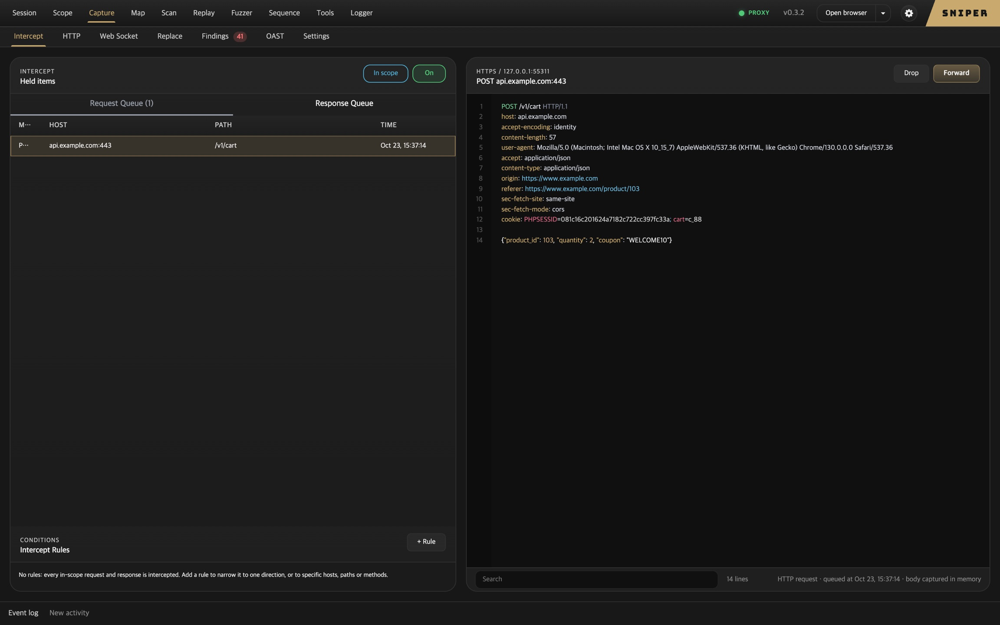
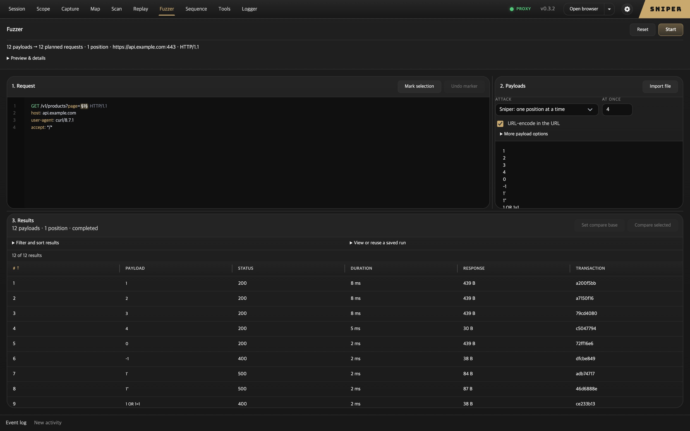
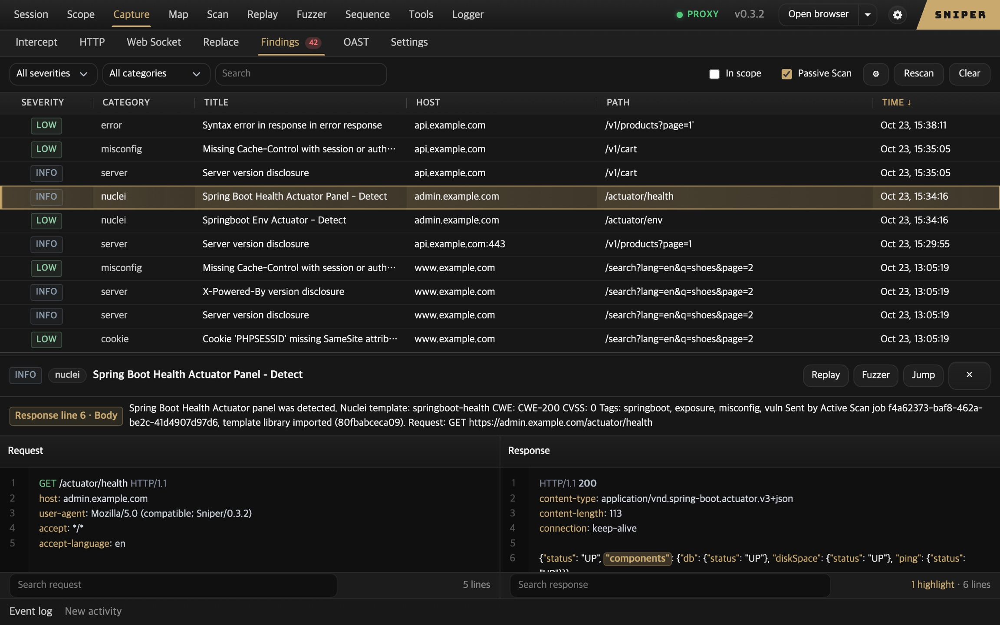
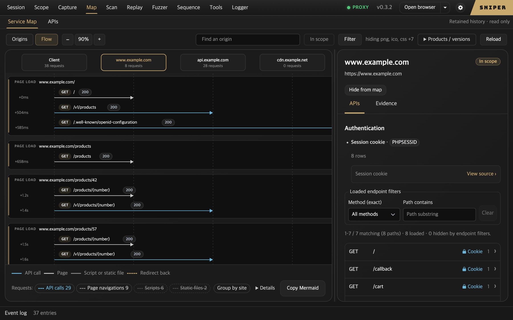
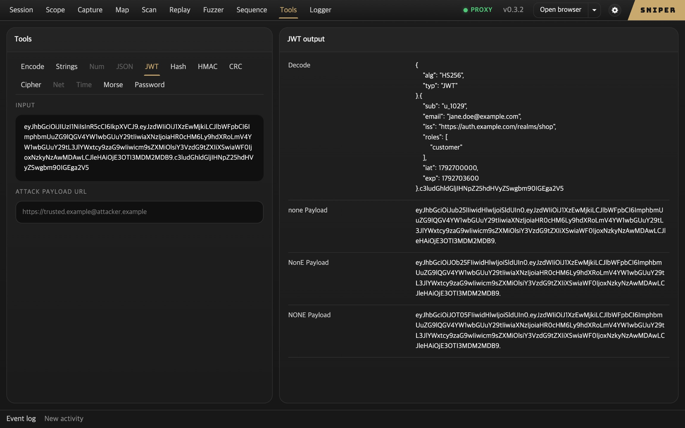

<p align="center">
  
</p>

<p align="center">
  <strong>Lightweight, fast, open-source web proxy for macOS, Windows and Linux</strong><br/>
  Built in Rust for web security testing.
</p>

<p align="center">
  <a href="https://github.com/sm1ee/Sniper/releases/latest"></a>
  
  <a href="https://github.com/sm1ee/Sniper/releases/latest"></a>
  <a href="https://github.com/sm1ee/Sniper/releases/latest"></a>
  <a href="https://github.com/sm1ee/Sniper/releases/latest"></a>
  <a href="LICENSE"></a>
</p>

<p align="center">
  
</p>

<p align="center">
  
</p>

<p align="center">
  
</p>

---

## What is Sniper?

Sniper is an open-source intercepting proxy for web security testing on macOS,
Windows and Linux (Debian 13). It intercepts, inspects and modifies HTTP/HTTPS
traffic between your browser and the internet, for penetration testers, bug
bounty hunters, security researchers and developers who debug APIs. It is a
native desktop app: one Rust binary with an embedded web UI and no runtime to
install. `sniper-cli` exposes the same operations as JSON, so scripts and coding
agents such as Claude Code and Codex can drive the same workflow.

## Install

### macOS

Install with Homebrew, which also puts `sniper-cli` on your `PATH`:

```bash
brew install --cask sm1ee/tap/sniper
```

Or download the latest `.dmg` from
[Releases](https://github.com/sm1ee/Sniper/releases/latest) and drag Sniper to
Applications. Releases are ad-hoc signed, not notarized, so on first launch you
may have to allow Sniper under System Settings ▸ Privacy & Security ▸
**Open Anyway**.

### Windows

Download the latest `-setup.exe` from
[Releases](https://github.com/sm1ee/Sniper/releases/latest) and run it, or
extract the portable `.zip` and open `sniper-desktop.exe`. Sniper runs on
Windows x64. Releases are not code-signed, so check each file against the
`.sha256` beside it with `Get-FileHash` first. See
[Windows setup](packaging/windows/README.md) for the WebView2 and runtime
prerequisites, HTTPS certificates and building from source.

### Linux

Debian 13 (trixie) on x86_64 with X11 is supported from v0.3.1. Download the
`.deb` or the portable `.tar.gz` from the
[latest release](https://github.com/sm1ee/Sniper/releases/latest) and check it
against its `.sha256`. Ubuntu, other distributions and Debian versions, ARM,
native Wayland and XWayland are not supported. See
[Linux installation](packaging/linux/README.md) for the GTK 3 and WebKitGTK 4.1
requirements and building from source.

### Build from source

```bash
cargo run --bin sniper-desktop   # Desktop app
cargo run --bin sniper           # Headless proxy + UI server
cargo run --bin sniper-cli       # CLI
cargo test                       # Tests
node --test tests/*.test.cjs      # Fixture-only frontend regressions (Node.js 18+)
./packaging/macos/release-macos.sh   # macOS .app + .dmg
```

## Quick start

1. Download and open Sniper.
2. Click **Open browser** in the top bar. The browser it opens already sends its
   traffic through Sniper and trusts Sniper's certificate.
   To use your own browser instead, set its HTTP proxy (not SOCKS) to
   `127.0.0.1:8080` and visit `https://sniper` to download and trust the root CA.
3. Start capturing.

Defaults: the proxy on `127.0.0.1:8080`, the headless server's UI on `127.0.0.1:23001`.

## Features

| Category | What you get |
|---|---|
| **Proxy** | HTTP forwarding, HTTPS MITM, authenticated HTTP/SOCKS5 proxy chaining, persistent root CA, `https://sniper` cert portal |
| **Browsers** | One click opens a browser already wired to the proxy and CA, and hands an AI agent the way to drive it |
| **Capture** | HTTP history, WebSocket sessions, intercept queue, match & replace rules, HTML and image responses rendered in a sandbox |
| **Findings** | Passive scanner: sensitive data, CORS, missing headers, JWT issues, and the management endpoints and backend addresses the Service Map names. Each issue is listed once per host, endpoint or value; **Rescan** applies the current rules to traffic already captured |
| **Scan ▸ Recon** | Session-owned endpoint discovery from a scoped static crawler, urlscan and Wayback, with explicit provider consent and optional budgets |
| **Scan ▸ Active Scan** | Nuclei community templates: turned-on templates check in-scope captured traffic without sending anything, and a manual scan sends the ones you pick to targets you name |
| **Replay** | Modify and resend any captured request, override host and port, render the response |
| **Fuzzer** | Payload lists sent at marked positions, Sniper or Battering ram, in the background with progress and Stop |
| **Tools** | Decode, encode, hash, JWT inspector, data transformations |
| **Sessions** | Isolated workspaces, each with its own records, scope and state |
| **Scope** | Host and wildcard filtering beside the captured hosts and paths |
| **Map** | A passive Service Map of the captured origins, their relations, and the APIs they serve |
| **Themes** | 12 themes: 7 dark, 5 light |
| **CLI** | `sniper-cli`, JSON-first automation for scripting |
| **AI Skills** | Claude Code and Codex skill templates built on `sniper-cli` |

## Screenshots

All captured from Sniper v0.3.2 with synthetic example.com traffic.

### Session

What every session holds before you open it: size, requests, findings, scope, pins, rules and scans.

<p align="center">
  
</p>

### Replay

Edit a captured request, send it again and read the answer beside it.

<p align="center">
  
</p>

### Scan ▸ Active Scan

Run Nuclei templates against targets you name; a match opens with the exchange that proved it.

<p align="center">
  
</p>

### Intercept

Hold a request on its way out, edit it, then forward or drop it.

<p align="center">
  
</p>

### Fuzzer

Send payload lists at marked positions and compare status, length and timing.

[Fuzzer quick start (한국어)](docs/guides/fuzzer-assisted-workflow.ko.md) shows what
to paste into Request and Payloads, how to mark a value, and how to preview before sending.

<p align="center">
  
</p>

### Findings

Passive checks and template matches, each with its evidence highlighted.
With **Findings** on in HTTP (or **Mark in HTTP** here), the same requests carry
a severity badge in Notes, a row tint (Settings ▸ Display) that the colour filter
gathers them by, and the highlighted evidence. A note or colour tag you set wins
over them.

<p align="center">
  
</p>

### Map ▸ Flow

One origin's requests in time order, page load by page load.

<p align="center">
  
</p>

### Tools

A pasted JWT opens the JWT tool: header and claims decoded, <code>alg: none</code> variants ready.

<p align="center">
  
</p>

## Wired browsers

**Open browser** opens ego, Aside or BrowserOS neo if you have one, otherwise an
installed Chrome, Edge, Brave or Chromium, with a profile of its own. The arrow
beside it lists the others, and **Make default** there saves your choice.
`sniper-cli capture browser open` does the same from a script; with `--agent` it
also hands an AI agent what it needs to drive the browser while Sniper records
every request.

| Browser | Platforms | An agent drives it through |
|---|---|---|
| Chrome, Edge, Brave, Chromium | macOS, Windows, Linux | the DevTools protocol (Playwright, chrome-devtools-mcp) |
| [ego](https://lite.ego.app/) | macOS | ego's own CLI and agent skill |
| [Aside](https://aside.com/) | macOS, Windows | Aside's CLI REPL |
| [BrowserOS neo](https://docs.browseros.com/neo/install) | macOS, Windows | its MCP server |

Sniper never installs a browser; a missing one links to its download page. The
[HTTP debugging guide](docs/guides/http-debugging.md#or-open-a-browser-that-is-already-wired)
covers profiles, `--fresh` and each driver.

## Remote headless UI

```bash
SNIPER_DATA_DIR=/tmp/sniper-headless \
SNIPER_UI_ADDR=192.168.1.10:23001 \
  cargo run --bin sniper
```

A non-loopback UI address (here `192.168.1.10`, or `0.0.0.0` for every
interface) turns on authentication for clients on other hosts: they open the
URL with the one-time bootstrap token that Sniper prints at startup. Sniper
serves plain HTTP, so across an untrusted network use an SSH tunnel or an
authenticated TLS reverse proxy.

## Proxy chain

In **Capture → Settings**, turn on **Proxy chain** and enter the upstream proxy,
such as `http://127.0.0.1:8081` or `socks5h://127.0.0.1:1080`, with an optional
username and password. Captured traffic, Replay, Fuzzer and Sequence then go
through it, and Sniper never falls back to a direct connection if it fails.
Hosts under **Connect directly to** (scope patterns such as `*.example.com`)
skip it. Settings are per session, and the password is stored in the session
files on disk. `sniper-cli capture proxy` reads the settings;
`sniper-cli capture proxy --stdin --yes` replaces them from JSON with `enabled`,
`url`, `username`, `password` and an optional `bypass_hosts` array.

## Render

The **Render** tab on responses in HTTP history, Replay and the fuzzer's results
draws HTML and images in a sandboxed frame with scripts, forms, links and
network access turned off. **Settings ▸ Display ▸ Render ▸ Load images, styles
and fonts** also fetches the images, stylesheets and fonts a page names, through
Sniper and the proxy chain. Those requests go to the target and to any other
host the page names, and they are not recorded in HTTP history. Scripts still
never run.

## Passive Service Map

The Map tool's Service Map summarizes the origins and endpoints in retained
history: the clients that sent the requests, how requests authenticate (never
the credential values), the technologies and exposures that scripts, pages and
error responses reveal, and API docs for origins that serve API data. It sends
nothing to a target, and it is an observed inventory, not a verified topology.
`sniper-cli scope service-map` reads the same data. The map's display filter
hides images, styles and fonts by default. `--only-parameterized` keeps only
requests whose URL has a query string;
JSON, form and multipart body fields do not match that filter.

In the GUI, up to eight inspected body references, Response Link declarations
and recorded socket-peer groups can be shown together in a session-local
collection that is never saved; see the
[collection behavior and lifetime limits](docs/integrations/service-map.md#session-local-retained-relationship-collection-gui-only).
The optional **Upstream socket peer** card in Capture Settings (off by default)
records the socket peer of future responses, which may be a proxy or CDN rather
than the origin's owner. See the
[Service Map contract](docs/integrations/service-map.md) and
[observed socket peer capture](docs/integrations/observed-socket-peer.md).

## Recon

**Scan ▸ Recon** builds a session-owned endpoint inventory from a scoped
static crawler, existing urlscan results and Wayback history. New urlscan
scans are a separate, explicit choice. Evidence distinguishes live responses,
observed references, historical records and unvisited candidates; discoveries
also appear in Scope's site map without becoming captured transactions.

The Codex and Claude Code operator skills can read, start and stop Recon:

```bash
sniper-cli recon list --session-id <session-uuid>
sniper-cli recon start --session-id <session-uuid> --target-url https://example.com/ --source crawler --max-requests 50 --max-depth 2 --max-endpoints 200 --dry-run
sniper-cli schema input recon.start
```

Use only an authorized target. Review the dry run before `--yes`; history
providers and new scans need separate sharing acknowledgments. Budgets default
to 0 (unbounded), and a CLI timeout does not stop the background job. See
[Recon's scope, consent and CLI contract](docs/integrations/recon.md).

## Nuclei templates

**Scan ▸ Active Scan** runs the community templates of
[projectdiscovery/nuclei-templates](https://github.com/projectdiscovery/nuclei-templates)
(MIT license) without the `nuclei` program. While Passive Scan is on, the
templates you turn on check responses from hosts that match a Scope include
pattern, without sending anything; with no Scope includes they check nothing.
A **manual scan** sends the templates you pick to the targets you name, when
you start it; the plan under the form says what it will send. Templates tagged intrusive, default-login,
bruteforce and the like, or that send PUT, DELETE or PATCH, run only if you
allow each risk, and `dos` templates never run. Out-of-band templates
(`{{interactsh-url}}`) are sent where the session has an Interactsh server
(**Capture ▸ OAST**) and match when the target calls back. Findings appear
under `nuclei`. A library downloaded from GitHub updates itself once a day;
**Update daily** in the library card turns that off.

```bash
sniper-cli templates library status
sniper-cli templates library download --yes
sniper-cli templates list --support passive --search wordpress
sniper-cli templates passive set-enabled --enabled true --tag waf --yes
sniper-cli templates scan preview --target https://app.example.com --severity critical
sniper-cli templates scan start --target https://app.example.com --severity critical --yes
```

See [the template contract](docs/integrations/nuclei-templates.md) for what runs
and where, the supported subset, the API and the CLI.

## CLI

`sniper-cli` ships with the macOS app and the Windows packages, and Homebrew puts
it on `PATH`. Otherwise use **Add to PATH**, offered on first launch and under
**Settings ▸ Runtime ▸ Command line**, or on macOS launch with
`SNIPER_INSTALL_CLI_PATH=1 open -a Sniper`. On macOS, move Sniper.app to
Applications first; registration adds one entry to your zsh profile and to an
existing `~/.bash_profile` or `~/.bashrc`. On Windows it adds the app folder to
your user PATH; before you move a portable folder, read
[Windows PATH ownership](packaging/windows/README.md#cli-and-headless-mode).
Open a new terminal afterwards.

```bash
sniper-cli session list
sniper-cli --output compact capture http list --limit 10
sniper-cli --output compact capture http search --value access_token
sniper-cli capture browser open --yes
sniper-cli capture http replay --id <id> --dry-run
sniper-cli capture http replay --id <id> --yes
sniper-cli scope set-scope --pattern '*.example.com' --yes
sniper-cli fuzzer run --yes
sniper-cli findings list --limit 20
sniper-cli findings get --id <finding-uuid>
sniper-cli findings count
sniper-cli event-log list --limit 20
```

Every operation marked `side_effect: "write"` in `sniper-cli manifest` needs
`--dry-run` to preview it or `--yes` to apply it. Subcommands print the API's raw
JSON. `call` runs any manifest operation by name and wraps its result in an
envelope; read the result from `data`. `--output compact` prints one-line JSON.

```bash
sniper-cli manifest
sniper-cli schema input replay.send
sniper-cli examples capture.http.list
sniper-cli --output compact call capture.http.list --input '{"limit":20,"page":true}'
sniper-cli --output compact call replay.send --input '{"tab_id":"<tab-id>"}' --dry-run
sniper-cli --output compact call replay.send --input '{"tab_id":"<tab-id>"}' --yes
printf "%s" "$OAST_TOKEN" | sniper-cli capture oast configure --provider custom --url https://oast.example --token-stdin --yes
```

The `findings` and `event-log` commands are reads and need no `--yes`. They read
the active session, or another one with `--session-id <uuid>` without switching
to it; `call` returns the ID it used in `meta.session_id`. Lists return the
newest 100 entries by default, `--limit` must be positive, and there is no
paging. `findings get` includes evidence that can hold sensitive captured
values. Nothing is redacted, so review the output before you give it to an agent
or save it.

Other CLI contracts:

- [Recon endpoint discovery](docs/integrations/recon.md): read, start and stop session-owned discovery jobs with explicit target and provider consent.
- [Passive scanner configuration](docs/integrations/passive-scanner.md): turn built-in checks on or off and manage custom rules.
- [Saved configuration edits](docs/integrations/saved-configuration-edits.md): change a saved intercept rule or a Replay tab's label.
- [Saved Replay tabs](docs/integrations/saved-replay-tabs.md): close, duplicate and pin saved HTTP Replay tabs.
- [Saved data v1](docs/integrations/saved-data-v1.md): opt-in `saved.v1.*` operations with durable mutation receipts.
- [HTTP history retention](docs/integrations/http-history-retention.md): automatic cleanup, off by default; when on, it permanently deletes the oldest unprotected rows.

## AI integration

```bash
sniper-cli skills install --all --dry-run
sniper-cli skills install --all --yes
```

This installs the `sniper-operator` skill for Claude Code and Codex;
`sniper-cli skills status --all` shows whether installed copies match this
build. On every launch the desktop app overwrites the copies in the default
folders (`~/.claude/skills` and `~/.codex/skills`, or `$CLAUDE_HOME/skills` and
`$CODEX_HOME/skills` when set), so local edits there do not last; a copy
installed with `--claude-dir` or `--codex-dir` is not updated. OpenCode reads
the Claude Code skill (see the
[Claude Code guide](docs/integrations/claude-code.md#opencode)).

## Documentation

| Guide | Answers |
| --- | --- |
| [Debugging HTTP with Sniper](docs/guides/http-debugging.md) | What can I do with this as a plain intercepting proxy? |
| [Sniper in an agent harness](docs/guides/agent-harness.md) | Which part of my harness is this, and what goes in and out? |
| [Using Sniper from Claude Code](docs/integrations/claude-code.md) | How do I install it, confirm it works, and what can I ask for? |
| [Using Sniper from Codex](docs/integrations/codex.md) | The same, for Codex |
| [Decoded value preview](docs/decoded-preview.md) | How do I read an encoded token without leaving the editor? |
| [Architecture](docs/architecture.md) | Why it is built this way, the tech stack, and where each part lives |
| [Contributing](AGENTS.md) | Build, test, and the invariants to not break |

## License

[MIT](LICENSE)
