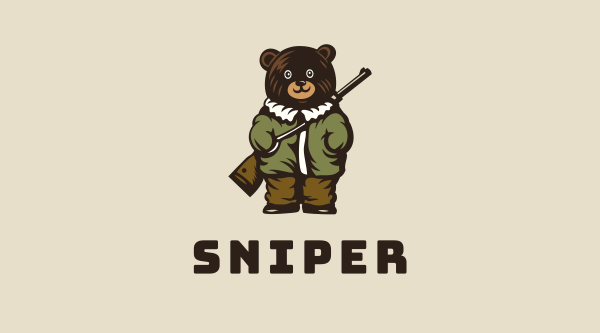
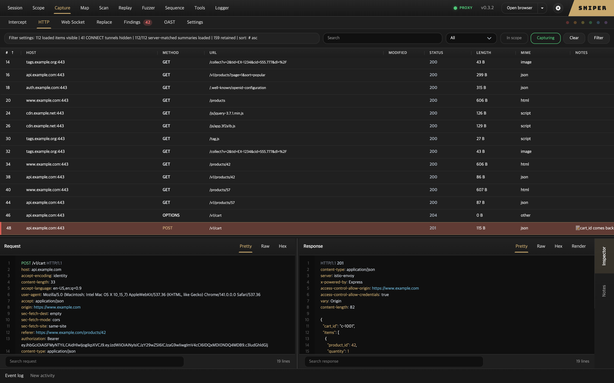
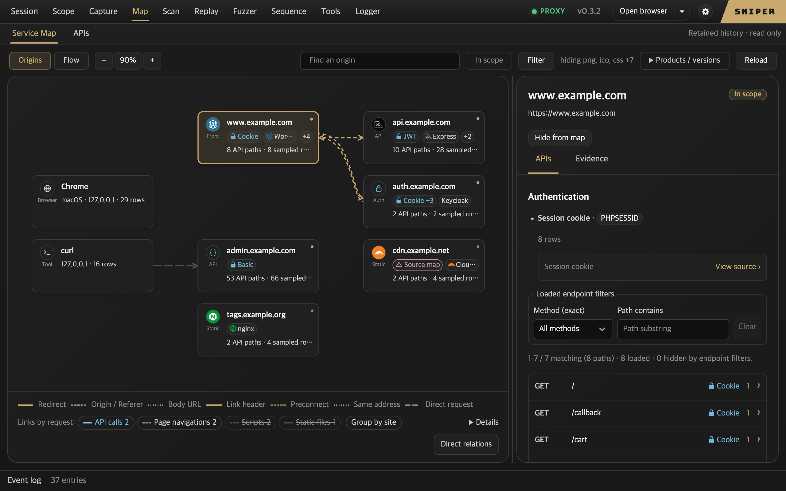
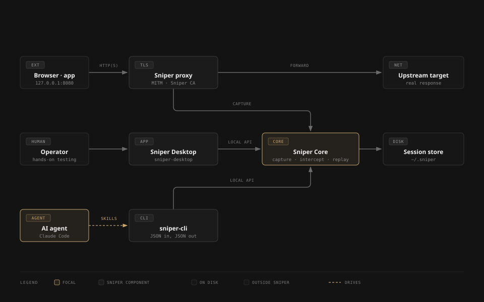

<p align="center">
  
</p>

<p align="center">
  <strong>Lightweight, fast, open-source web proxy for macOS, Windows and Linux</strong><br/>
  A modern alternative to heavy proxy platforms — built in Rust, designed for security testing.
</p>

<p align="center">
  <a href="https://github.com/sm1ee/Sniper/releases/latest"></a>
  
  <a href="https://github.com/sm1ee/Sniper/releases/latest"></a>
  <a href="https://github.com/sm1ee/Sniper/releases/latest"></a>
  <a href="https://github.com/sm1ee/Sniper/releases/latest"></a>
  <a href="LICENSE"></a>
</p>

<p align="center">
  
</p>

<p align="center">
  
</p>

<p align="center">
  
</p>

---

## What is Sniper?

Sniper is an **open-source desktop web security proxy** for macOS, Windows and Linux (Debian 13). It intercepts, inspects, and modifies HTTP/HTTPS traffic between your browser and the internet — the core workflow for web application security testing, bug bounty hunting, and API debugging.

If you've used an intercepting proxy before, the workflow will be familiar. Sniper is a **native desktop app** written in Rust with an embedded web UI.

**Who it's for:** penetration testers, bug bounty hunters, security researchers, and developers who need to see what's happening on the wire.

## Install

### Windows

**Download the latest `-setup.exe`** from [Releases](https://github.com/sm1ee/Sniper/releases/latest) and run it.
Each installer ships with a `.sha256` beside it; check it with `Get-FileHash` before running,
since releases are not yet code-signed.

Run the Windows setup executable built by `packaging/windows/make-setup.ps1`, or extract a Windows ZIP built by `packaging/windows/make-zip.ps1` and open `sniper-desktop.exe`. Building from source requires the MSVC Rust toolchain. See [Windows setup and packaging](packaging/windows/README.md) for WebView2/runtime prerequisites, HTTPS certificates, CLI usage, and isolated testing. Windows x64 is the first Windows target.

### Linux: Debian 13 x86_64 on X11

**Debian 13 (trixie), x86_64, X11 is supported from v0.3.1.** Download the
`.deb` or the portable `.tar.gz` from the
[latest release](https://github.com/sm1ee/Sniper/releases/latest) and check it
against its `.sha256`; the release also carries the build manifest and the CI
runtime check. Or build from the `v0.3.1` tag.

See [Linux installation, source and CI artifacts](packaging/linux/README.md)
for the qualification boundary, system GTK 3/WebKitGTK 4.1 requirements,
checksums and installation instructions. Ubuntu, other distributions or Debian
versions, ARM, native Wayland and XWayland are outside this support claim.

### macOS

**Install with Homebrew**, which also puts `sniper-cli` on your `PATH`:

```bash
brew install --cask sm1ee/tap/sniper
```

Or **download the latest `.dmg`** from [Releases](https://github.com/sm1ee/Sniper/releases/latest), open it, and drag Sniper to your Applications folder.
Releases are ad-hoc signed, not notarized, so on first launch macOS may ask you to
allow Sniper under System Settings ▸ Privacy & Security ▸ **Open Anyway**.

Or build from source:

```bash
cargo run --bin sniper-desktop
```

## Features

| Category | What you get |
|---|---|
| **Proxy** | HTTP forwarding, HTTPS MITM, authenticated HTTP/SOCKS5 proxy chaining, persistent root CA, `https://sniper` cert portal |
| **Browsers** | One click opens Chrome, Edge, Brave, Chromium, ego, Aside or BrowserOS neo already wired to the proxy and CA, and hands an AI agent the way to drive it |
| **Capture** | HTTP history, WebSocket sessions, intercept queue, match & replace rules |
| **Findings** | Passive vulnerability scanner — sensitive data, CORS, missing headers, JWT issues |
| **Replay** | Modify and resend any captured request |
| **Fuzzer** | Payload-based request testing with markers |
| **Tools** | Decode, encode, hash, JWT inspector, data transformations |
| **Sessions** | Isolated workspaces — each with its own records, scope, and state |
| **Scope** | Host and wildcard filtering beside the captured hosts and paths |
| **Map** | A passive retained-history Service Map of the captured origins and their relations, and the APIs they serve |
| **Themes** | 12 themes — 7 dark + 5 light, gold-accent design language |
| **CLI** | `sniper-cli` — JSON-first automation for scripting |
| **AI Skills** | Built-in Claude & Codex skill templates using `sniper-cli` |

## Why Sniper?

- **Native.** One Rust binary with no runtime to install. It opens immediately and stays small while it runs.
- **Scriptable.** `sniper-cli` speaks JSON for the operations the UI exposes, so reviewing a capture or resending a request can be driven from a shell script.
- **Agent-ready.** Claude Code and Codex skill templates ship in the repository, so a coding agent drives the same workflow through the same CLI. OpenCode reads the Claude Code one (see the [Claude Code guide](docs/integrations/claude-code.md#opencode)).

## Quick start

1. Download and open Sniper
2. Click **Open browser** in the top bar. It opens ego, Aside or BrowserOS neo if
   you have one, otherwise an installed Chrome, Edge, Brave or Chromium, already sending its
   traffic through Sniper and trusting its certificate, so there is nothing to
   configure. The arrow beside it lists the others, and **Make default** there saves
   your choice.
   To use a browser of your own instead, point its proxy at `127.0.0.1:8080` and
   visit `https://sniper` to download and trust the root CA.
3. Start capturing

Default listeners:
- Proxy: `127.0.0.1:8080`
- UI: `127.0.0.1:23001` (headless mode)

## Wired browsers

**Open browser** starts a browser that is ready for testing: its traffic goes
through Sniper, it trusts Sniper's certificate, and it keeps a profile of its own,
apart from your everyday one. There is nothing to set up. `sniper-cli capture
browser open` does the same from a script, and with `--agent` it also hands an AI
agent what it needs to drive that browser while Sniper records every request.

| Browser | Platforms | An agent drives it through |
|---|---|---|
| Chrome, Edge, Brave, Chromium | macOS, Windows, Linux | the DevTools protocol (Playwright, chrome-devtools-mcp) |
| [ego](https://lite.ego.app/) | macOS | ego's own CLI and agent skill |
| [Aside](https://aside.com/) | macOS, Windows | Aside's CLI REPL |
| [BrowserOS neo](https://docs.browseros.com/neo/install) | macOS, Windows | its MCP server |

Sniper never installs a browser: one that is missing appears in the menu with a link
to its download page. Aside and BrowserOS neo have been checked on macOS, not yet on
Windows. The [HTTP debugging guide](docs/guides/http-debugging.md#or-open-a-browser-that-is-already-wired)
covers profiles, `--fresh` and what each driver offers.

### Remote headless UI

The headless UI can bind directly to any local address when remote access is
required:

```bash
SNIPER_DATA_DIR=/tmp/sniper-headless \
SNIPER_UI_ADDR=192.168.1.10:23001 \
  cargo run --bin sniper
```

Use `0.0.0.0:23001` instead to listen on every IPv4 interface. Any non-loopback
UI listener requires authentication for clients connecting from another host.
At startup Sniper prints a URL containing a random one-time token. An exact bind
address produces a ready-to-open URL; for a wildcard bind, replace `0.0.0.0`
with the machine's reachable address. Sniper exchanges the token for an HttpOnly
session cookie, removes the token from the address bar, and rejects any later
attempt to reuse it. Restart Sniper to issue a new token if the browser session
is lost. Same-machine clients, including `sniper-desktop` and `sniper-cli`,
remain trusted.

Sniper serves HTTP rather than TLS, so do not expose this listener directly to
an untrusted network. Use an SSH tunnel or an authenticated TLS reverse proxy
for access across one.

## Core workflow

```
Session → Scope → Capture → Replay → Fuzz
                    │
          ┌─────────┼─────────┐
      Intercept    HTTP    WebSocket
                    │
               Findings (passive scan)
```

- **Session** — isolated workspaces with their own records and state
- **Scope** — define target domains/paths, auto-filter traffic, and see the captured hosts and paths beside them
- **Map** — the Service Map of the captured origins, how they relate, and the APIs they serve, from retained history
- **Capture** — inspect HTTP, render HTML and image responses in a sandbox, intercept & modify, WebSocket frames, auto-replace
- **Findings** — passive scanner detects sensitive data leaks, CORS misconfig, missing security headers, JWT weaknesses, and the management endpoints and backend addresses the Service Map names; each issue is listed once per host, endpoint or value
- **Replay** — resend with modifications, override host/port, render the response
- **Fuzzer** — insert markers, run payload lists
- **Tools** — decode/encode/hash/JWT in one place

## Proxy chain

In **Capture → Settings**, enable **Proxy chain** and enter an upstream proxy
address (`http://127.0.0.1:8081` or `socks5h://127.0.0.1:1080`). Optional username
and password fields support HTTP Basic authentication and SOCKS5 authentication.
`socks5://` is also accepted and resolves destination names remotely, like
`socks5h://`. This configures an outbound chain; Sniper's incoming listener
continues to accept HTTP proxy requests and CONNECT, not SOCKS client requests.

The chain applies to captured HTTP/HTTPS traffic, TLS passthrough, WebSockets,
Replay, and HTTP requests sent by Fuzzer/Sequence. Chain failures never fall
back to direct connections. Existing WebSocket connections keep their current
route until reconnected.

**Connect directly to** lists hosts that skip the chain, such as a local test
service the upstream proxy cannot reach. It takes the same patterns as scope
(`*.example.com` covers the domain and its subdomains) and applies to every path
above. Hosts not on the list keep using the chain, and an empty list changes
nothing. Replay's separate connection-target override works only when its target
is on this list; otherwise edit the request destination instead.

Settings belong to each session and persist across restart. Passwords are
masked in API responses and stored in the session files on disk. Leaving the
masked value unchanged preserves the saved password; clearing it removes the
password. Environment proxy variables do not override this explicit setting.

Automation can read settings with `sniper-cli capture proxy`. To replace them,
pipe a JSON object with `enabled`, `url`, `username`, and `password` into
`sniper-cli capture proxy --stdin --yes`; `--dry-run` previews the operation
without consuming credentials. Add `bypass_hosts` (an array of patterns) to
replace the direct-connection list; leaving it out keeps the saved list. The manifest operations are `capture.proxy.get`
and `capture.proxy.configure` (the latter reads settings from stdin).

## Render

Every response in HTTP history, Replay and the fuzzer's results has a
**Render** tab beside Pretty, Raw and Hex. It draws HTML and images in a
sandboxed frame inside the pane: scripts, forms, links and network access are
off, so a captured page cannot run or call anything, Sniper's own API included.

By default it draws only what the response holds, so a page whose look comes
from external stylesheets shows unstyled. **Settings ▸ Display ▸ Render ▸ Load
images, styles and fonts** also fetches what the page names (images,
stylesheets and their imports, fonts) through Sniper and the session's proxy
chain, and writes them into the page; scripts still never run. Those requests
go to the target and to any other host the page names, and are not recorded in
HTTP history.

## Passive Service Map

The Map tool's Service Map summarizes origins and method-plus-exact-path endpoints from
retained capture metadata, with counts, bounded evidence, scope state, header
clues, and redirect instructions. The UI and `sniper-cli scope service-map` share
the same read model. No probing, scanning, replay, crawling, or redirect following
is performed. Always inspect the reported completeness and unavailable fields;
this is an observed inventory, not a verified infrastructure topology. See the
[Service Map contract and examples](docs/integrations/service-map.md).

The map has its own display filter, as Burp's site map does: the HTTP history
filter's conditions (MIME type, status class, hidden extensions and the rest),
kept apart from History's. By default it hides images, styles and fonts, so a
page's static CDN and its arrows drop out. `sniper-cli scope service-map` takes
the same conditions as `--mime-types`, `--status-classes`, `--hidden-extensions`,
`--hide-without-responses` and `--only-parameterized`.

Each row's User-Agent names the client that sent it (a browser, an app's
WebView, an app, a tool, a library or a crawler), and the map's first column
shows the clients, each with an arrow to the origins where the map starts;
selecting one draws an arrow to each origin it went to itself. An origin whose
rows carried no typed response stays off the map unless selected or searched for.
How requests authenticate (a bearer JWT, Basic, session cookies, API key headers,
OAuth, OpenID Connect or SAML) is named from headers and URLs, never their values.
An origin that serves API data opens as API docs from its inspector, laid out
as Swagger UI lays them out and sent on to Replay a row at a time, and
`sniper-cli scope service-map openapi` reads the same OpenAPI 3.1 document: path
templates, parameter and body field names with guessed types, statuses and
media types, and the credentials sent, never their values. What no rule names
(a `Server` value, a vendor header or cookie name) is kept for a person or an
agent to judge; `sniper-cli scope service-map unnamed` lists it across the
whole map, most widespread first, with the origins, evidence and the products
named beside each signal.

Origin and Referer links are sorted by request kind (API call, page navigation,
frame, script, static file), read from `Sec-Fetch-Dest`. The legend toggles each
kind; frames, scripts and static files draw no arrows by default, and an arrow
grows heavier with its rows. Each link also counts the responses that let its
source read them through CORS, with or without credentials. Origins of one site
share a card by default, and any origin or site can be hidden from the map.

A separate, explicit `sniper-cli target service-map body-references --session-id
<active-session-uuid> --evidence-id <returned-token>` read can inspect one retained
UTF-8 HTML/JavaScript response preview. It returns canonical origins and preview
byte offsets, with truncation and limits; literal references do not prove calls
or ownership. The session must already be active. Default map/evidence reads
remain metadata-only apart from scripts and pages, read for the front-end
frameworks, CMSs and libraries they name and the keys, source maps and private
addresses they give away, and error and debug responses, read for the servers
behind an origin and what they expose; they send no target requests. The UI's map
covers every retained row; the CLI reads the newest `--max-records` rows, or every
row with `--all-rows`. An endpoint's parameters (query, form and JSON fields, with
a few values) are read when it is opened.

In the GUI, explicitly inspected body references, Response Link declarations and
recorded socket-peer groups can coexist in a session-local map collection, with
up to eight exact-source entries. Typed reference arrows and undirected recorded
address spokes retain separate provenance and coverage; they do not prove calls
or common ownership. Show, filters, selection and per-entry removal make no extra
reads. The collection is never persisted and shares the existing 24-card/40-edge
limits. Unrelated record events preserve verified body/Link entries; peer groups
still clear when history changes because unsampled membership cannot be proved
unchanged. See the
[collection behavior and lifetime limits](docs/integrations/service-map.md#session-local-retained-relationship-collection-gui-only).

An optional **Upstream socket peer** Capture Settings card records one bounded
socket observation for eligible future ordinary captured HTTP(S) responses. It
is Off by default, uses explicit Save/Cancel, and never backfills or probes.
`capture http upstream-peer get/set --session-id <active-session-uuid>` exposes
the same active-session settings; set requires `--enabled true|false --yes`.
An exact evidence read adds it only with `--include-socket-peer`. A socket peer
may be a proxy, CDN or shared endpoint and does not establish origin ownership.
Observations persist in session files, exports and full-record JSON; Off does not
erase them. See [the observed socket peer contract](docs/integrations/observed-socket-peer.md).

## CLI

For what changed in 0.3.1, see the
[CLI and saved-workspace maintenance overview](docs/guides/maintenance-0.3.1.md).

`sniper-cli` is already bundled with the macOS app and Windows packages. The
first desktop launch offers **Add to PATH** or **Later** when registration is
available and needed. Later dismisses the prompt without changing PATH; use
**Settings ▸ Runtime ▸ Command line** whenever you want to register or retry.
Homebrew and already-registered copies skip the prompt. No external CLI or
agent skill is installed by this option.

On macOS, move Sniper.app to Applications first. Registration adds one guarded
entry to your zsh profile (`$ZDOTDIR/.zshrc`, or `~/.zshrc`) and existing
`~/.bash_profile` / `~/.bashrc` files. On Windows, registration appends the
installed or extracted app folder to the current user's PATH. Windows Setup
also has an unchecked CLI PATH option. Existing PATH entries and unrelated
commands are preserved; a conflicting `sniper-cli` is reported instead of
replaced. Open a new terminal afterwards (on Windows, restart your terminal app
if it retains the previous environment).

Keep a portable Windows folder in a stable location after registration. If you
move it, use Windows Environment Variables to replace its old **user PATH** entry
with the new folder. Automatic setup conservatively leaves an earlier ownership
record alone, so removing the old entry and retrying Settings is not a relocation
workflow. See [Windows PATH ownership and uninstall](packaging/windows/README.md#cli-and-headless-mode)
for the conservative cleanup rules.

For an explicit macOS launch-time opt-in:

```bash
SNIPER_INSTALL_CLI_PATH=1 open -a Sniper
```

```bash
sniper-cli session list
sniper-cli --output compact capture http list --limit 10
sniper-cli --output compact capture http search --value access_token
sniper-cli capture browser open --yes
sniper-cli capture http replay --id <id> --dry-run
sniper-cli capture http replay --id <id> --yes
sniper-cli scope set-scope --pattern '*.example.com' --dry-run
sniper-cli scope set-scope --pattern '*.example.com' --yes
sniper-cli fuzzer run --dry-run
sniper-cli fuzzer run --yes
```

Legacy subcommands keep their original raw JSON success output for compatibility. `call` success output is wrapped in an automation envelope; use `--output compact` for one-line JSON and read `call` results from `data`.

AI/automation callers can invoke manifest operations directly:

```bash
sniper-cli --output compact call capture.http.list --input '{"limit":20,"page":true}'
sniper-cli --output compact call replay.send --input '{"tab_id":"<tab-id>"}' --dry-run
sniper-cli --output compact call replay.send --input '{"tab_id":"<tab-id>"}' --yes
```

Stored findings and session event logs are available through read-only commands:

```bash
sniper-cli findings list --limit 20
sniper-cli findings get --id <finding-uuid>
sniper-cli findings count
sniper-cli event-log list --limit 20
sniper-cli --output compact call findings.list --input '{"limit":20}'
sniper-cli --output compact call event_log.list --input '{"limit":20}'
```

These commands resolve the active session once, then pin that ID for the read.
Pass `--session-id <uuid>` (or `session_id` in `call`) to read another session
without switching it. `call` includes the resolved ID in `meta.session_id`; reuse
it for related detail/count reads. Direct commands return the API's bare arrays,
finding object, or `{count}` object. No `--yes` is needed, and `--dry-run` stays
offline.

Both lists default to the newest 100 retained entries. `--limit` must be positive;
there is no offset/cursor pagination or filtered count. `findings count` returns
all findings currently retained in the session. List and count are separate reads,
so new or removed findings can change the result between them.

`findings list` omits detail and evidence. `findings get` includes stored detail
and evidence, which can contain sensitive captured values; it does not fetch the
linked HTTP transaction or its raw bodies. Summary metadata and event messages
can also be sensitive. These reads do not add redaction: review the output before
sharing it with an agent or saving it to a transcript. No scanner execution,
configuration, or clear operation is exposed by these commands.

### Existing rule settings and saved tab labels

```bash
sniper-cli capture intercept-rule update --id <rule-uuid> --path-pattern /saved --dry-run
sniper-cli capture intercept-rule update --id <rule-uuid> --clear-methods --yes
sniper-cli capture intercept-rule set-enabled --id <rule-uuid> --enabled false --yes
sniper-cli call capture.intercept_rule.update --input '{"id":"<rule-uuid>","host_pattern":"","method_filter":[]}' --dry-run
sniper-cli replay update --tab-id '11111111-1111-4111-8111-111111111111' --label "Saved conversation" --yes
```

Rule updates patch only supplied fields of an existing rule. Omission preserves
current values; empty host/path strings and an empty method list clear those
matchers. `set-enabled` assigns an explicit boolean and never toggles or creates
a rule. Label-only `replay.update` supports saved HTTP and WebSocket tabs and
preserves every other saved tab field. Request and target edits remain HTTP-only.
These writes require `--yes`; `--dry-run` is offline. Prefer an explicit
`--session-id` to select an inactive session without changing the active session.
See [saved configuration edits](docs/integrations/saved-configuration-edits.md)
for partial-update, session, concurrency and failure semantics.

### Saved HTTP Replay tab housekeeping

```bash
sniper-cli replay close --tab-id 'exact-tab-id' --dry-run
sniper-cli replay close --tab-id 'exact-tab-id' --yes
sniper-cli replay duplicate --tab-id 'exact-tab-id' --session-id <session-uuid> --yes
sniper-cli replay set-pinned --tab-id 'exact-tab-id' --pinned true --yes
sniper-cli call replay.duplicate --input '{"tab_id":"exact-tab-id"}' --dry-run
sniper-cli schema output replay.close
```

`replay.close`, `replay.duplicate`, and `replay.set_pinned` accept an exact
`tab_id` and optional `session_id`. Set-pinned also requires an explicit boolean
(`--pinned true` or `--pinned false`; JSON `pinned` for `call`). IDs are never
trimmed or matched by label; blank IDs and IDs over 128 UTF-8 bytes are rejected. Only saved HTTP tabs (including legacy empty tab
types) are supported. All require `--yes`; `--dry-run` is entirely offline and
cannot check whether the tab exists.

Close removes only that tab and its saved replay history. Closing the active tab
selects its previous neighbor in the stable pinned-first visual order, or the next
neighbor when there is no previous one. Duplicate clones the saved tab and history
with a fresh UUID, unpinned, and a new sequence above the current counter and all
tab sequences; it preserves current focus. Set-pinned assigns the requested pin
state while preserving focus, physical array order, counters, and tab content. Repeating the same value never toggles
it; each accepted write still advances the workspace revision. None of these
operations reparse requests, hydrate response bodies, send traffic, or change
unrelated saved data.

The CLI pins one session (explicit IDs also work for inactive sessions), reads its
workspace revision, then sends one metadata-only compare-and-swap request.
An inferred session is guarded against an active-session switch. Conflicts and lost, invalid,
or redirected responses are never retried. Inspect saved tabs before a deliberate
retry; these operations do not use `saved.v1` receipts.

Success is bounded metadata: `session_id`, `revision`, `active_tab_id`, and either
`closed_tab_id`, `source_tab_id` plus `new_tab_id`, or `tab_id` plus `pinned`.
Direct commands return that object; `call` puts it under `data` and adds
`meta.session_id`. See the
[saved-tab API contract](docs/integrations/saved-replay-tabs.md) for wire details.

### Opt-in HTTP history retention

Capture → Settings → HTTP History automatic cleanup saves a policy per session. Off is
always the default, preserving existing traffic. Explicitly enabling keep-newest
allows permanent deletion of the oldest unprotected excess rows. N is a soft
**total-history** target: in-progress records and source originals referenced by
durably saved HTTP Replay tabs are protected, so totals can stay above N.

```bash
sniper-cli capture http retention get --session-id <session-uuid>
sniper-cli capture http retention set --max-entries 10000 --session-id <session-uuid> --dry-run
sniper-cli capture http retention set --max-entries 10000 --session-id <session-uuid> --yes
sniper-cli capture http retention set --off --session-id <session-uuid> --yes
```

N must be an integer from 1 through 4294967295. Dry-run is completely offline;
`--yes` is required to save either policy. Saved-policy success is separate from
pending logical cleanup and disk reclamation. Off does not restore deleted rows.
Canonical operations are `capture.http.retention.get` and
`capture.http.retention.set`. See [the retention contract](docs/integrations/http-history-retention.md)
for session binding, concurrency, metadata, protection, and uncertain outcomes.

### Passive scanner configuration

The `scanner` commands manage the existing passive checks for captured response
body previews and request/response headers. They do not send traffic, fetch full
bodies, run probes, rescan saved transactions, or clear findings. Disabling a rule
only affects later passive processing; configuration edits do not clear existing
findings. Opening an unloaded legacy session uses normal journal recovery, which
can reconstruct missing saved findings; these commands add no separate rescan.

```bash
sniper-cli scanner config get
sniper-cli scanner custom list --session-id <session-uuid>
sniper-cli scanner custom get --id example-header
sniper-cli scanner config set-enabled --enabled false --dry-run
sniper-cli scanner config set-enabled --enabled false --yes
sniper-cli scanner builtin set-enabled --id header --enabled false --yes
sniper-cli scanner custom create --file rule.json --dry-run
sniper-cli scanner custom create --file rule.json --yes
printf '%s' '{"enabled":false,"description":""}' | sniper-cli scanner custom update --id example-header --stdin --yes
sniper-cli scanner custom delete --id example-header --yes
```

A create input is one complete rule, with an explicit stable ID:

```json
{
  "id": "example-header",
  "name": "Example header marker",
  "enabled": true,
  "target": "response_header",
  "header_name": "X-Example",
  "pattern": "example-marker",
  "severity": "info",
  "category": "example",
  "description": "Synthetic passive marker."
}
```

Targets are `response_body`, `response_header`, and `request_header`; severity is
`info`, `low`, `medium`, `high`, or `critical`. Patterns must be valid Rust regexes.
`header_name` defaults to `""`; for header targets this searches all captured
headers. Body rules inspect the stored preview, which may be truncated. A rule
field is limited to 64 KiB of UTF-8; a config to 250 custom rules and 4 MiB.

An update input is a nonempty partial rule object without `id`. Omitted fields are
preserved, `false` disables, and `""` clears optional text. Unknown fields, nulls,
invalid patterns/targets/severities, blank IDs/names/patterns, and empty patches
are rejected. Update, get, and delete match the exact ID, never a name or partial
ID. Create rejects duplicate IDs. Custom rule order and unrelated settings are
preserved. List/get expose stored patterns and text, which may contain sensitive
values; review them before sharing output.

Canonical operations are `scanner.config.get`, `scanner.config.set_enabled`,
`scanner.builtin.set_enabled`, and `scanner.custom.list`, `.get`, `.create`,
`.update`, `.delete`. For `call`, create takes a nested `rule`; update takes `id`
and a nested `patch`. Alternatively, either operation takes `file` or
`stdin: true`, with exactly one source. The outer `--input` also accepts `@file`
and `-` for stdin; do not use `--input -` and `stdin: true` together.

```bash
sniper-cli call scanner.config.set_enabled --input '{"enabled":false}' --dry-run
sniper-cli call scanner.custom.create --input '{"file":"rule.json"}' --yes
sniper-cli call scanner.custom.update --input '{"id":"example-header","patch":{"enabled":false,"description":""}}' --yes
sniper-cli schema input scanner.custom.update
sniper-cli examples scanner.custom.create
```

All commands are session-scoped. Use `--session-id` (or `session_id` in `call`) to
select an inactive session without switching it. Otherwise the CLI resolves the
active session once and pins that ID; writes also guard against an active-session
switch. Every mutation requires `--yes`. `--dry-run` validates supplied JSON
before API discovery and remains strictly offline, so it cannot check whether an
ID exists or whether a saved config has changed.

Writes fetch the selected config and its `config_token`, change only the requested
part, then compare-and-swap once. A stale config or changed active session returns
409; a missing API precondition returns 428. Neither conflicts nor failed/lost
responses are retried automatically. Inspect the current config before a deliberate
retry. There is no arbitrary full-config overwrite command. Unchanged requests
return `changed: false` without posting; successful writes return `session_id`,
`config_token`, `changed`, and `id` when applicable, after the API confirms saving.

Direct API clients must update their write contract: `POST /api/scanner-config`
now requires complete `enabled`, `rules`, and `custom_rules` fields plus
`expected_config_token` from the selected session's latest GET. Unguarded legacy
replacements are rejected. A successful POST returns `200` with snapshot JSON
instead of the previous `204` empty response. Persisted legacy configurations
remain readable; the storage format is unchanged.

Direct list/get return the rule array/object. Config get returns the config,
`session_id`, `config_token`, and builtin ID/name metadata. `call` keeps the normal
success envelope with the result under `data` and the pinned ID in
`meta.session_id`. Errors keep the existing JSON error envelope.

All side-effecting commands with `side_effect: "write"` in `sniper-cli manifest` require `--dry-run` or `--yes`.

```bash
sniper-cli manifest
sniper-cli schema input replay.send
sniper-cli examples capture.http.list
printf "%s" "$OAST_TOKEN" | sniper-cli capture oast configure --provider custom --url https://oast.example --token-stdin --yes
```

For saved-data management, the opt-in `saved.v1.*` contract provides strict schemas,
bounded session-pinned pages, and durable mutation receipts. Existing commands keep
their output format. See [saved-data contract v1](docs/integrations/saved-data-v1.md).

## AI integration

```bash
sniper-cli skills install --all --dry-run
sniper-cli skills install --all --yes
```

Check installed skill files without modifying them:

```bash
sniper-cli skills status --all
sniper-cli skills status --codex --codex-dir /tmp/example-skills
sniper-cli call skills.status --input '{"claude":true}'
sniper-cli schema output skills.status
```

Select at least one of `--codex`, `--claude`, or `--all`. Optional
`--codex-dir` and `--claude-dir` specify skills roots, just as for install.
Status reads only this CLI host's `sniper-operator/SKILL.md` files, even when
`--api` points elsewhere. It performs no API discovery, installation, directory
creation, or update; `--yes` is not needed. Discovery, schemas, examples, and
`--dry-run` are offline and do not inspect installed files.

The result has `scope: "cli_host"`, the CLI's `bundled_version`, and `entries`
with agent, absolute path, bundled and installed SHA-256 hashes, and status.
`current` means exact byte equality; `modified_or_outdated` only means the hashes
differ. The installed version is unknown, so differences cannot distinguish
user edits from an older template. `missing`, `unreadable`, and `unsupported`
report files that could not be compared; the installed hash is null and error
rows include `error_code`. Reads are byte-bounded and reject final-component symlinks/reparse points,
non-regular files, and oversized files. Ancestor directory links retain normal
filesystem semantics; this is not a general filesystem I/O timeout. Source text is never returned.
Completed inspections exit zero, including missing/error rows: automation must
check each row's `status` and `error_code`. Invalid arguments or failure to
resolve a selected path exit nonzero. Existing install behavior is unchanged.

### Local skill maintenance

`skills update-preview` compares active installed bytes with this binary's bundle
without writing. Experimental enrollment and staging preserve a known baseline.
The partial activation milestone adds explicit `skills apply-update --yes`,
read-only `skills update-result`, and transaction-bound `skills rollback-update
--yes`. Keep the original canonical lowercase operation UUID for inspection and
rollback, especially after interrupted or lost output. Different bytes must come
from a strictly newer bundled semantic version; edited or mismatched files are
refused, and recovery artifacts are preserved.

These explicit operations do not themselves grant automatic-update consent.
Automatic updates are Off by default. `skills enable-auto-updates --codex --yes`
records host-local consent for one unchanged managed installation without
updating it immediately. `skills auto-update-status --codex` reads the policy;
`skills auto-update-once --codex --yes` attempts an eligible bundled update, and
`skills disable-auto-updates --codex --yes` revokes future updates. Use `--claude`
for Claude. Status, disable and one-shot execution use the stored target and
reject directory overrides. Re-enabling an existing policy requires its current
`--policy-revision` and creates fresh authorization. The desktop schedules one
background pass after its first idle event; no agent reload or network template
fetch occurs. Uncertain attempts pause rather than silently retrying.

Linux exchange is covered by native fixtures. Hosted macOS 15 ARM64
[focused policy/transaction tests and native desktop compilation](https://github.com/sm1ee/Sniper/actions/runs/38423109820)
were verified at `e7cbe95`. Actual GUI behavior, Intel Macs and user-installed
skills remain unverified. Windows activation, rollback, transaction-result
inspection and host-policy operations are currently unsupported. See [safe skill maintenance](docs/integrations/skill-maintenance.md)
for the review workflow, confirmation requirements, recovery and platform limits.

AI agents can drive the full workflow through CLI — capture, scope, replay, fuzz — no UI scraping needed.

- [Using Sniper from Claude Code](docs/integrations/claude-code.md)
- [Using Sniper from Codex](docs/integrations/codex.md)
- [Sniper in an agent harness](docs/guides/agent-harness.md) — which part of a harness this is, and when you do not need it

## Documentation

| Guide | Answers |
| --- | --- |
| [Debugging HTTP with Sniper](docs/guides/http-debugging.md) | What can I do with this as a plain intercepting proxy? |
| [Sniper in an agent harness](docs/guides/agent-harness.md) | Which part of my harness is this, and what goes in and out? |
| [Using Sniper from Claude Code](docs/integrations/claude-code.md) | How do I install it, confirm it works, and what can I ask for? |
| [Using Sniper from Codex](docs/integrations/codex.md) | The same, for Codex |
| [Architecture](docs/architecture.md) | Why it is built this way |
| [Contributing](AGENTS.md) | Build, test, and the invariants to not break |

## Tech stack

| Layer | Technology |
|---|---|
| Core | **Rust** — proxy, MITM, TLS, session management |
| HTTP | `hyper` + `tokio` async runtime |
| TLS | `rustls` + `rcgen` for on-the-fly certificate generation |
| UI server | `axum` serving embedded SPA |
| Frontend | Vanilla **JS** + **CSS** — zero framework, zero build step |
| Desktop shell | Native **WebView** (`wry`) |
| Packaging | macOS `.app` + `.dmg`; Windows portable `.zip`; Debian 13 x86_64 development candidates (`.tar.gz` + `.deb`); each includes desktop, server and CLI |

## Build from source

```bash
cargo run --bin sniper-desktop   # Desktop app
cargo run --bin sniper           # Headless proxy + UI server
cargo run --bin sniper-cli       # CLI
cargo test                       # Tests
node --test tests/*.test.cjs      # Fixture-only frontend regressions (Node.js 18+)
./packaging/macos/release-macos.sh   # macOS .app + .dmg
```

## Project layout

```
src/
├── proxy.rs           # Proxy core, HTTPS MITM, replay
├── api.rs             # UI/API server (axum)
├── scanner.rs         # Passive vulnerability scanner
├── session.rs         # Session registry & snapshots
├── certificate.rs     # Root CA generation & export
├── store.rs           # HTTP transaction store
├── model.rs           # Normalized data models
├── intercept.rs       # Request intercept queue
├── match_replace.rs   # Auto match & replace rules
├── fuzzer.rs          # Payload fuzzer engine
├── websocket.rs       # WebSocket capture
├── bin/
│   ├── sniper-desktop.rs   # Native desktop shell (wry)
│   └── sniper-cli.rs       # JSON-first CLI
web/                   # Frontend SPA (vanilla JS/CSS)
packaging/
├── macos/             # .app & .dmg packaging scripts
└── skills/            # Claude & Codex skill templates
```

## License

[MIT](LICENSE)
