<p align="center">
  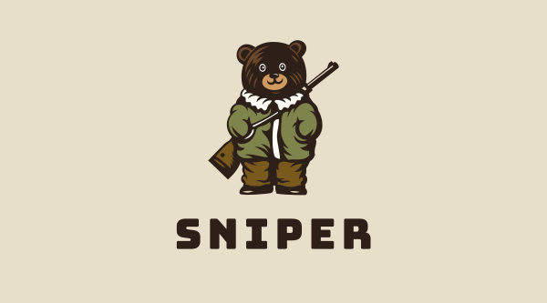
</p>

<p align="center">
  <strong>Open-source intercepting proxy for web security testing on macOS, Windows and Linux</strong><br/>
  One Rust binary with the UI built in.
</p>

<p align="center">
  <a href="https://github.com/sm1ee/Sniper/releases/latest"></a>
  
  <a href="https://github.com/sm1ee/Sniper/releases/latest"></a>
  <a href="https://github.com/sm1ee/Sniper/releases/latest"></a>
  <a href="https://github.com/sm1ee/Sniper/releases/latest"></a>
  <a href="LICENSE"></a>
</p>

<p align="center">
  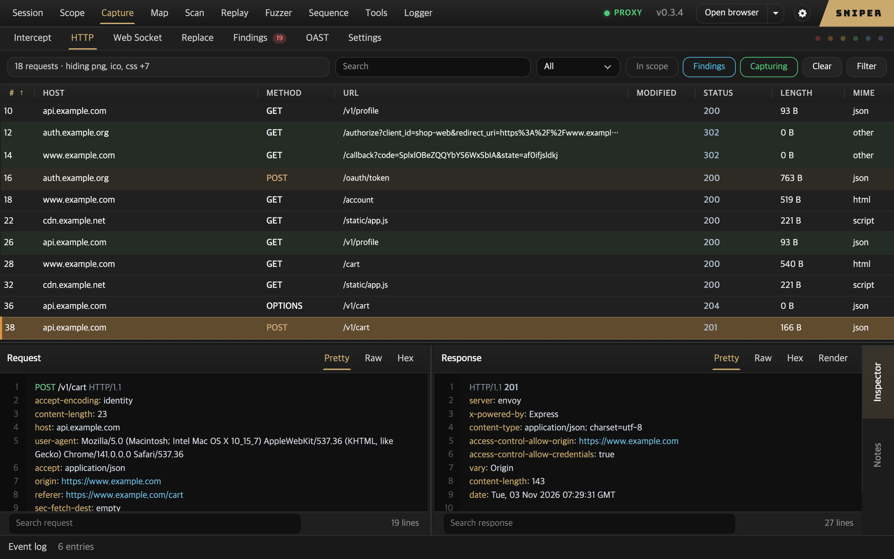
</p>

<p align="center">
  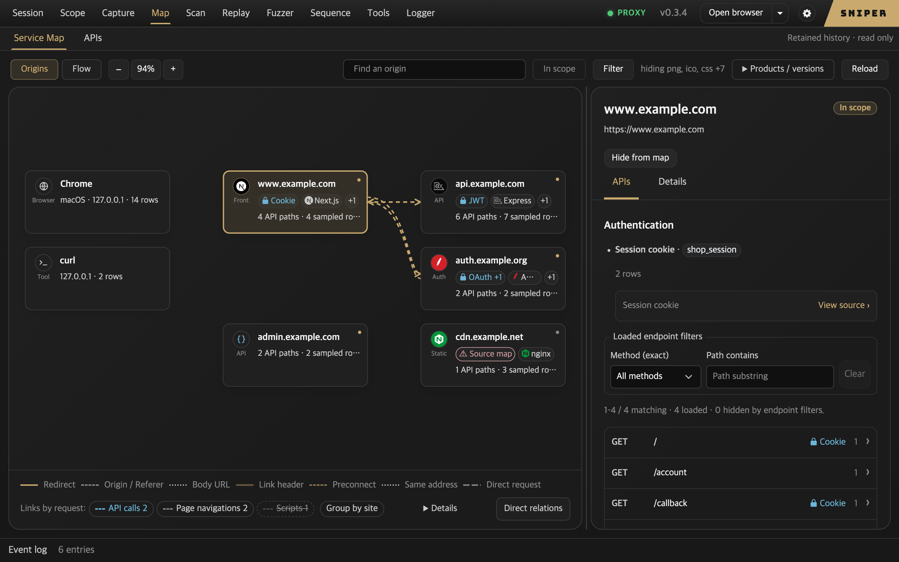
</p>

<p align="center">
  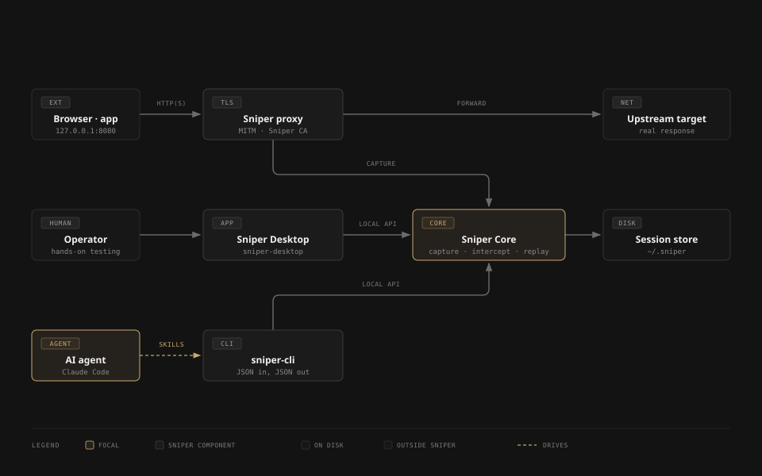
</p>

---

## What is Sniper?

Sniper captures, holds, edits and replays the HTTP and HTTPS traffic between a
browser and the sites you test. It runs on macOS, Windows and Linux (Debian 13)
as one Rust binary with the UI built in. `sniper-cli` runs the same operations
as JSON, so scripts and coding agents such as Claude Code and Codex can use it
too.

## Install

### macOS

Install with Homebrew, which also puts `sniper-cli` on your `PATH`:

```bash
brew install --cask sm1ee/tap/sniper
```

Or download the latest `.dmg` from
[Releases](https://github.com/sm1ee/Sniper/releases/latest) and drag Sniper to
Applications. Releases are ad-hoc signed, not notarized, so the first launch may
need **Open Anyway** under System Settings ▸ Privacy & Security.

### Windows

Download the latest `-setup.exe` from
[Releases](https://github.com/sm1ee/Sniper/releases/latest) and run it, or
extract the portable `.zip` and open `sniper-desktop.exe` (Windows x64).
Releases are not code-signed, so check each file against the `.sha256` beside it
with `Get-FileHash` first. [Windows setup](packaging/windows/README.md) covers
WebView2 and runtime prerequisites, HTTPS certificates and building from source.

### Linux

Debian 13 (trixie) on x86_64 with X11 is supported from v0.3.1. Download the
`.deb` or the portable `.tar.gz` from the
[latest release](https://github.com/sm1ee/Sniper/releases/latest) and check it
against its `.sha256`. Ubuntu, other distributions and Debian versions, ARM,
native Wayland and XWayland are not supported.
[Linux installation](packaging/linux/README.md) lists the GTK 3 and
WebKitGTK 4.1 requirements and how to build from source.

### Build from source

```bash
cargo run --bin sniper-desktop   # Desktop app
cargo run --bin sniper           # Headless proxy + UI server
cargo run --bin sniper-cli       # CLI
cargo test                       # Tests
node --test tests/*.test.cjs      # Fixture-only frontend regressions (Node.js 18+)
./packaging/macos/release-macos.sh   # macOS .app + .dmg
```

## Quick start

1. Download and open Sniper.
2. Click **Open browser** in the top bar. That browser already sends its traffic
   through Sniper and trusts Sniper's certificate
   ([which browsers](docs/guides/http-debugging.md#or-open-a-browser-that-is-already-wired)).
   To use your own browser, set its HTTP proxy (not SOCKS) to `127.0.0.1:8080`
   and visit `https://sniper` to download and trust the root CA.
3. Browse. Requests appear in HTTP history.

Defaults: the proxy on `127.0.0.1:8080`, the headless server's UI on `127.0.0.1:23001`.

## Features

| Category | What you get |
|---|---|
| **Proxy** | HTTP forwarding, HTTPS MITM, upstream HTTP/SOCKS5 proxy chain with login, persistent root CA, `https://sniper` certificate page |
| **Browsers** | One click opens a browser wired to the proxy and CA, which an AI agent can also drive |
| **Capture** | HTTP history, WebSocket sessions, intercept queue, match & replace rules, HTML and image responses rendered in a sandbox |
| **Findings** | Passive checks for sensitive data, CORS, missing headers, JWT issues, and the management endpoints and backend addresses the Service Map names. One entry per issue per host, endpoint or value; **Rescan** re-checks captured traffic |
| **Scan ▸ Recon** | Endpoint discovery per session from a scoped crawler, urlscan and Wayback, with consent per external service and optional limits |
| **Scan ▸ Active Scan** | Nuclei community templates: turned-on templates check captured in-scope traffic without sending anything; a manual scan sends the ones you pick to targets you name |
| **Replay** | Edit and resend any captured request, override host and port, render the response |
| **Fuzzer** | Payload lists sent at marked positions (Sniper or Battering ram), in the background with progress and Stop |
| **Tools** | Decode, encode, hash, JWT inspector, data transformations |
| **Sessions** | Separate workspaces, each with its own records, scope and state |
| **Scope** | Host and wildcard filters beside the captured hosts and paths |
| **Map** | A passive Service Map of captured origins, how they relate, and the APIs they serve |
| **Themes** | 12 themes: 7 dark, 5 light |
| **CLI** | `sniper-cli`, JSON-first automation for scripts |
| **AI Skills** | Claude Code and Codex skills built on `sniper-cli` |

## Screenshots

All captured from Sniper v0.3.4 with synthetic example.com traffic.

### Session

Each session's size, requests, findings, scope, pins, rules and scans, before you open it.

<p align="center">
  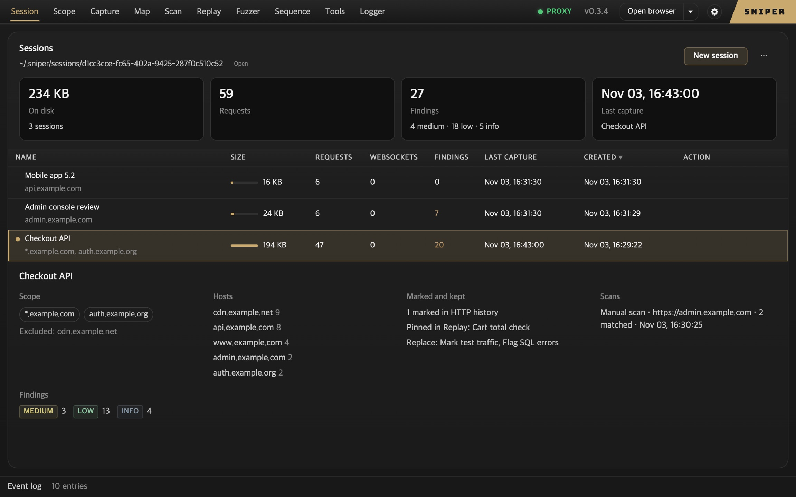
</p>

### Replay

Edit a captured request, send it again and read the answer beside it.

<p align="center">
  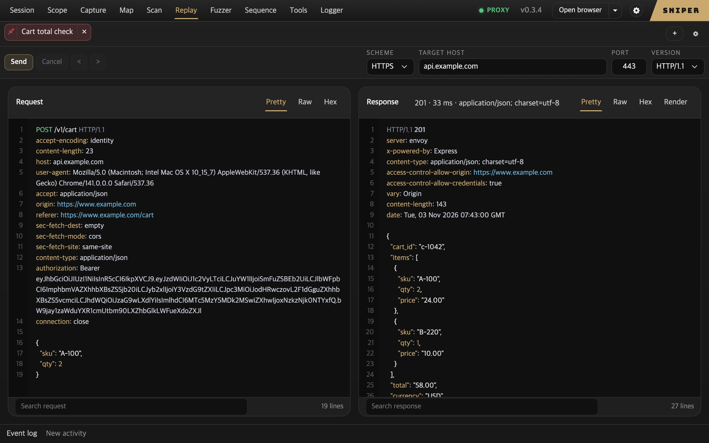
</p>

### Scan ▸ Active Scan

Run Nuclei templates against targets you name; a match opens with the exchange that proved it.

<p align="center">
  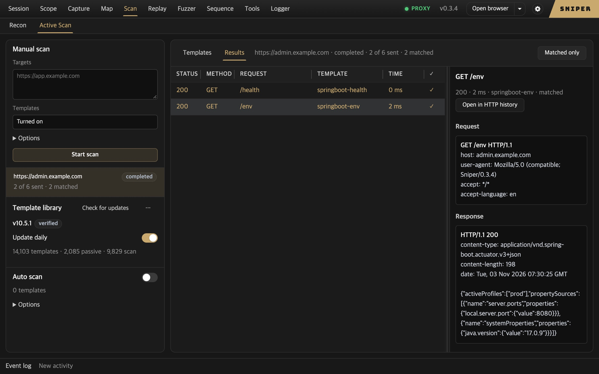
</p>

### Intercept

Hold a request on its way out, edit it, then forward or drop it.

<p align="center">
  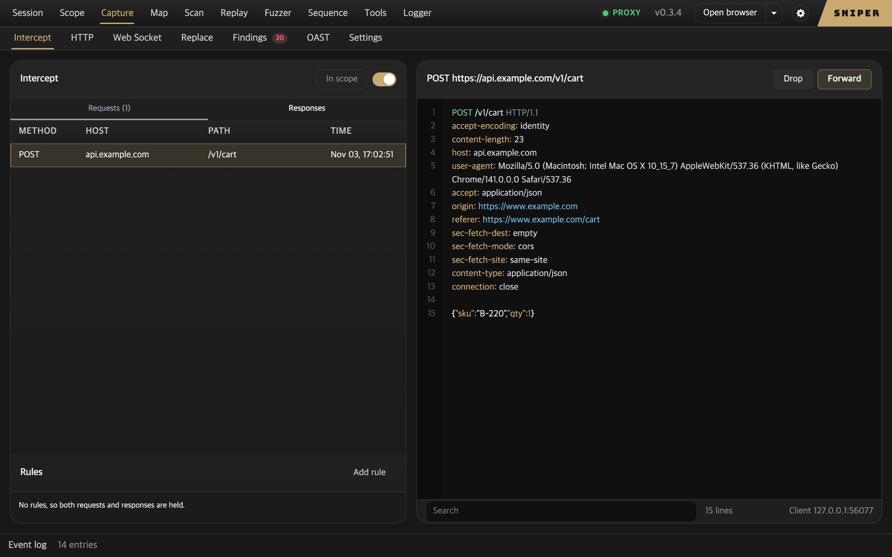
</p>

### Fuzzer

Send payload lists at marked positions and compare status, length and timing.
The [Fuzzer quick start (한국어)](docs/guides/fuzzer-assisted-workflow.ko.md)
shows what to paste, how to mark a value and how to preview before sending.

<p align="center">
  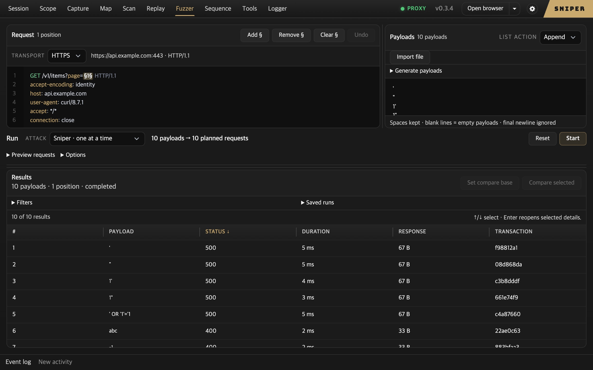
</p>

### Findings

Passive checks and template matches, each with its evidence highlighted.

<p align="center">
  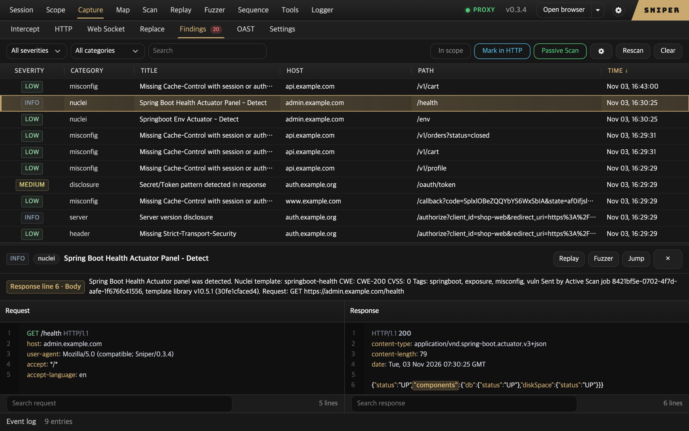
</p>

### Map ▸ Flow

One origin's requests in time order, page load by page load.

<p align="center">
  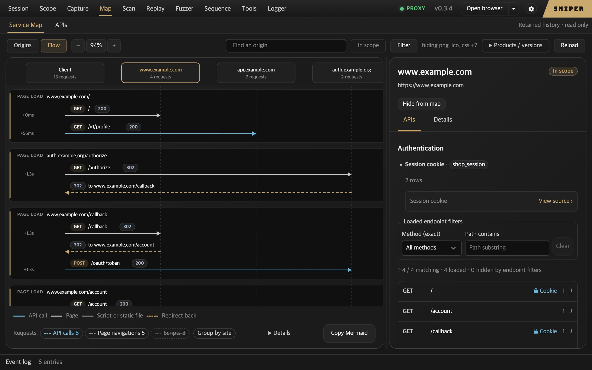
</p>

### Tools

A pasted JWT opens the JWT tool: header and claims decoded, <code>alg: none</code> variants ready.

<p align="center">
  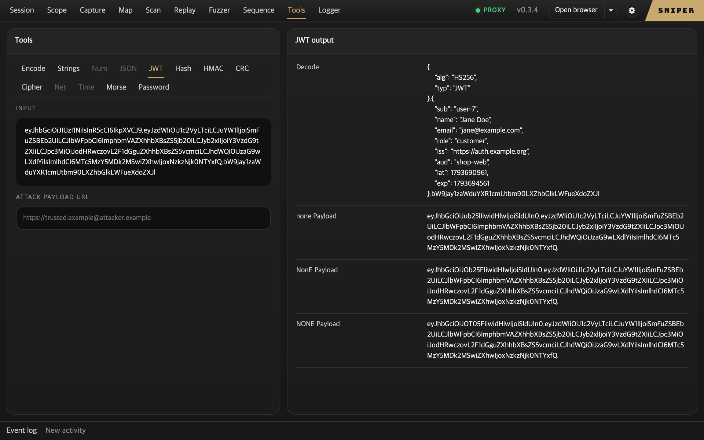
</p>

## CLI and AI agents

`sniper-cli` runs every operation as JSON against the running Sniper. Writes
need `--dry-run` to preview or `--yes` to apply.

```bash
sniper-cli --output compact capture http list --limit 10
sniper-cli capture http replay --id <id> --dry-run
sniper-cli skills install --all --yes
```

The last command installs the `sniper-operator` skill for Claude Code and Codex.
[Using sniper-cli](docs/guides/cli.md) covers PATH setup, the manifest and every
CLI contract.

## Documentation

| Guide | Covers |
| --- | --- |
| [Debugging HTTP with Sniper](docs/guides/http-debugging.md) | Starting Sniper, wired browsers, the UI from another machine, proxy chains, Render, scope and Replay |
| [Using sniper-cli](docs/guides/cli.md) | PATH setup, everyday commands, reads and writes, agent skills, CLI contracts |
| [Service Map](docs/integrations/service-map.md) | The passive map of captured origins, their clients and the APIs they serve |
| [Recon](docs/integrations/recon.md) | Endpoint discovery, consent for external services, limits |
| [Nuclei templates](docs/integrations/nuclei-templates.md) | Passive templates, manual and auto scans, what never runs |
| [Sniper in an agent harness](docs/guides/agent-harness.md) | Which part of a harness Sniper is, and what goes in and out |
| [Using Sniper from Claude Code](docs/integrations/claude-code.md) | Installing the skill, checking that it works, what to ask for |
| [Using Sniper from Codex](docs/integrations/codex.md) | The same, for Codex |
| [Decoded value preview](docs/decoded-preview.md) | Reading an encoded token without leaving the editor |
| [Architecture](docs/architecture.md) | Why it is built this way, the tech stack, and where each part lives |
| [Contributing](AGENTS.md) | Build, test, and the invariants to not break |

## License

[MIT](LICENSE)
