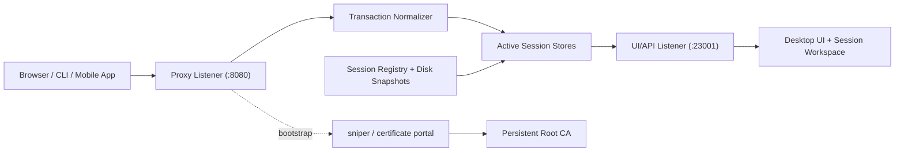
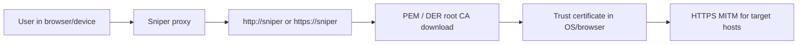

# Sniper Architecture

## Design

Sniper is a local traffic proxy built around a direct capture workflow:

- traffic enters through a dedicated proxy listener
- captured transactions are normalized into a single in-memory store
- a separate UI/API listener renders records and detail panels
- a local certificate authority bootstraps trust through a dedicated `sniper` host
- a session registry isolates traffic, rules, and runtime settings per workspace
- new features should plug into the shared transaction model through explicit
  stages (accept, normalize, intercept, forward, post-process, persist/publish)
  instead of coupling directly to socket logic

Rust fits this: low memory overhead and good concurrency for proxy I/O, a single
deployable binary, strong type boundaries between capture, storage and UI/API,
and room to grow into high-volume workflows without rewriting the core.

| Layer | Technology |
|---|---|
| Core | **Rust** — proxy, MITM, TLS, session management |
| HTTP | `hyper` + `tokio` async runtime |
| TLS | `rustls` + `rcgen` for on-the-fly certificate generation |
| UI server | `axum` serving the embedded SPA |
| Frontend | Vanilla **JS** + **CSS**, no framework and no build step |
| Desktop shell | Native **WebView** (`wry`) |

## System layout

In desktop mode the same core runs in one process behind a native window: an
embedded WebView talks to a local UI/API listener on an automatic port, and that
listener and the proxy share the in-memory ring buffer and event bus. The shell
uses WebKit on macOS and WebView2 on Windows. The WebView2 profile lives under
the data directory, so an installation in a read-only application folder still
works.

## Modules

- `src/proxy.rs`: accepts HTTP proxy traffic, forwards plain HTTP upstream,
  terminates `CONNECT` for HTTPS MITM, and terminates `CONNECT sniper:443`
  locally to serve the certificate portal.
- `src/certificate.rs`, `src/special_host.rs`: the persistent root CA and the
  `http://sniper` / `https://sniper` portal that serves it as PEM and DER.
- `src/store.rs`: a bounded ring buffer of transactions that emits live events
  to the UI.
- `src/session.rs`: session metadata and the active workspace; persists each
  session's settings, records, WebSockets, rules and fuzzer records under
  `data_dir/sessions/<session-id>`.
- `src/model.rs`: the transaction schema shared by the proxy, the API and other
  tooling.
- `src/scanner.rs`: the passive vulnerability scanner.
- `src/intercept.rs`, `src/match_replace.rs`: the request intercept queue and
  the match & replace rules.
- `src/fuzzer.rs`, `src/websocket.rs`: the payload fuzzer engine and WebSocket
  capture.
- `src/service_map*.rs`, `web/service-map.js`: the Service Map, a bounded,
  on-demand projection of retained history. It starts no network discovery and
  keeps no persistent index; see [Service Map](integrations/service-map.md).
- `src/api.rs`: the record and detail APIs, the embedded UI, root CA downloads,
  and authentication for a non-loopback UI listener.
- `src/bin/sniper-desktop.rs`: runs the proxy and UI listeners in one process
  and opens the UI in a native window.
- `src/bin/sniper-cli.rs`: the JSON-first CLI.
- `src/platform.rs`: the data directory shared by desktop, server and CLI, plus
  Windows file locks, process identity and persistence operations.
- `web/`: the frontend SPA, in vanilla JS and CSS.
- `packaging/macos/`, `packaging/skills/`: the `.app` and `.dmg` packaging
  scripts, and the Claude and Codex skill templates.

## UI access

Same-machine UI clients are trusted, so the desktop shell and `sniper-cli` need
no credentials. A non-loopback UI listener authenticates clients from other
hosts before it serves assets or API routes. The bootstrap token is generated
in memory, printed once at startup, consumed on first use, and exchanged for an
HttpOnly, SameSite session cookie that expires with the server process.

## Persistence

File contents are synced before replacement. Unix also syncs the parent
directory; Windows has no equivalent, so it uses write-through renames. On
Windows, journal workers close their handles before acknowledging commands,
because an open journal blocks renaming its session directory for deletion.
Rotation uses a separate writable handle because an append-only handle cannot
truncate a file, and snapshot rewrites close their source reader before
replacing the file.

### Interrupted session deletion

Deleting a session moves its storage into a `.deleted-<session UUID>-<UUID>`
quarantine, then commits the registry tombstone. If that registry write and the
rollback both fail, the data can stay in quarantine while the registry still
lists the session. Startup then refuses to run, and leaves the registry, the
quarantine and any canonical directory untouched; it does not restore or merge
them. It also refuses quarantine evidence beside a missing, corrupt or
incomplete registry, and malformed quarantine names, because an uncertain
deletion must not be completed only because its directory looks like debris.
Quarantines from a normal deletion with a valid registry are still cleaned up.

To recover, stop Sniper and back up the whole sessions directory first;
deleting a quarantine can discard the original data. The check runs only at
startup, so a running process can still recreate partial canonical storage
after a failed rollback. The next startup then stops and keeps both copies.

## HTTP history search

The desktop history adds `search_headers=true` to its page reads, so quick and
advanced searches also match complete request and response header names and
values, but never across the boundary between metadata and headers. Plain
header matching ignores ASCII case unless case-sensitive search is on. The
store caches a case-preserving and an ASCII-folded header string per record,
without loading bodies, at a memory and payload cost proportional to header
size. UI pages and live summaries carry that text, and the authenticated UI
event stream carries full headers, because the UI filters rows locally. The
text is never persisted or written to event logs, and default list responses
stay metadata-only.

## Bootstrap and trust flow

Sniper generates one local root CA and reuses it across restarts. The GUI and
the `sniper` host both export it, and it is used right away for HTTPS MITM on
any host.

## Known tradeoffs

- Request bodies are fully collected before they are forwarded.
- HTTPS MITM speaks HTTP/1.1 to the client side.
